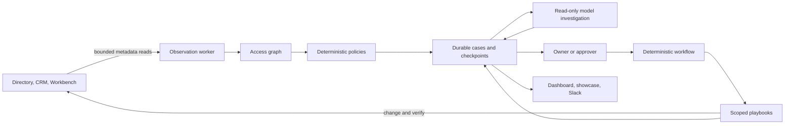

# Architecture

Autonomous Security System demonstrates an evidence-to-remediation workflow over
Helio, a synthetic company. Awasi is the intended evaluator and the existing demo
agent's name; this repository is an independent prototype.

## Evidence and action flow

There are three enabled detection rules: inactive owner with agent access, a
public app with confidential data access, and an agent with an unapproved
destination. Decision rules determine when to contain, ask an owner, escalate,
or require review. A model recommendation is advisory.

## Components

| Directory | Responsibility |
| --- | --- |
| `src/helio_simulator/` | Employment and team directory |
| `src/helio_crm/` | Synthetic customer API, authentication, grants, access enforcement, optional activity capture |
| `src/helio_workbench/` | Internal apps, agents, destinations, visibility, and activity metadata |
| `src/outside/` | Local external-receiver simulation; records confirmed delivery counts |
| `src/helio_security/` | Connectors, graph, policies, cases, model investigation, approvals, playbooks, and optional webhook pipeline |
| `src/helio_dashboard/` | Server-side API gateway and graph/case interface |
| `showcase/` | Per-browser temporary environments and guided scenario controls |

The main Docker stack uses Neo4j for access relationships and SQLite for service
state, cases, and workflow checkpoints. The showcase reuses real service handlers,
observation and policy code, workflows, and playbooks, but substitutes an in-memory
graph projection and temporary databases. The two modes demonstrate the same
scenario concepts, not identical persistence or deployment characteristics.

## Trust boundaries

- Observers receive metadata rather than raw customer payloads. Read and action
  credentials are separate; neither is passed to the browser.
- The model receives bounded, projected evidence and read tools. It cannot select
  arbitrary mutation tools or bypass required approvals.
- Workflows save action intent and reconcile uncertain outcomes through read-back.
  Verification, rather than an attempted write, determines success. Unresolved
  ambiguity is retained for review.
- Slack checks the responding user's mapping. The solo demo deliberately lets one
  configured user play the fictional roles; it is not production SSO.
- The showcase binds to loopback and separates browser sessions. Browser decisions
  act as the local demo operator, not an authenticated enterprise employee.
- Source snapshots have independent observation times. Stale or missing evidence
  must not be presented as proof that a risk is resolved.

## Detection, events, and timing

The main demo polls source APIs (the local setup uses a 15-second interval).
The optional CRM pipeline captures correlated requests and responses, delivers
signed events, persists an inbox, and recovers missing activity. Workbench does
not yet provide a webhook-driven graph update path. The planned periodic AI
review of suspicious logs and inline prevention are not implemented in this v1.

Containment can stop subsequent access, but it cannot undo an earlier disclosure.
An anonymous public-app probe itself records a view; interpret that evidence in
context rather than assuming every view is an outside attacker.

## Entry points for a code review

1. [Rules](../src/helio_security/rules.py) and
   [decisions](../src/helio_security/decision.py): detection versus action authority.
2. [Investigator](../src/helio_security/investigator.py): bounded read tools,
   evidence references, completion reserve, and optional wording repair.
3. [Cases](../src/helio_security/cases.py) and
   [workflow](../src/helio_security/workflow.py): durable state and human decisions.
4. [Actions](../src/helio_security/actions.py) and
   [Workbench playbooks](../src/helio_security/workbench_playbooks.py): mutation,
   reconciliation, and verification.
5. [Acceptance tests](../tests/test_v1_acceptance.py) and
   [showcase tests](../showcase/tests/test_showcase.py): observable scenario behavior.

See [known limitations](known-limitations.md) before treating this as a deployment
architecture. Source package and Compose names retain Helio/Awasi identifiers to
preserve existing imports, service discovery, stored identifiers, and demo data.
