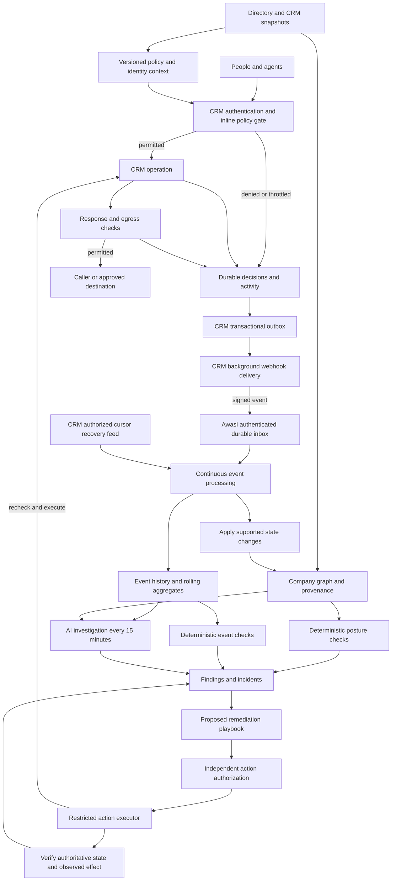

# Awasi autonomous security architecture and implementation plan

Status: architecture proposed for review, 2026-10-30. Phases 0–1 now have an opt-in
operation-activity implementation; see the [implemented contract](crm-activity-contract.md).
The remaining architecture describes future behavior, not currently active features.
Revision: prioritize complete CRM activity capture and authorized webhook delivery
to Awasi before adding policies; retain request and response enforcement in the target design.
Execution breakdown: [implementation phases](implementation-phases.md) defines the
current selectable phases 0–28 and replaces the earlier broad phase numbering.

## Recommendation

The hybrid approach is feasible and a good foundation: deterministic prevention,
continuous evidence collection, periodic AI investigation, and controlled remediation.
Its effectiveness depends on trustworthy context and enforcement coverage more than
on how many rules or agents it contains. Passing the configured checks establishes
that an operation is permitted by those checks; it does not prove benign intent.

Use four connected components:

1. **Inline enforcement:** authenticate and evaluate deterministic rules before
   mutations, data release, tool execution, and outbound transmission.
2. **Continuous observation:** the CRM durably records activity and pushes signed
   webhooks to Awasi. Awasi durably accepts events, then evaluates event policies
   without waiting for the 15-minute AI review. Preserve independent source reconciliation.
3. **AI investigation:** every 15 minutes, examine new activity with historical and
   graph context, including allowed activity that generated no deterministic finding.
4. **Remediation:** execute narrow, policy-authorized actions, verify their effects,
   and retain an audit trail. AI proposes or selects playbooks; it does not determine
   its own permissions or receive unrestricted administrative access.

The original two deterministic categories describe where ideas came from, rather
than different execution architectures. Classify rules by the evidence and timing
they need: request, response/egress, rolling activity window, or graph posture.
Merge the overlapping sensitive-pattern and credential-leakage proposals into one
scanner with separate secret and PII detectors and different action policies.

The immediate next milestone is the environment: complete activity instrumentation,
response evidence, reliable CRM-to-Awasi webhook delivery, and observable ingestion.
Policy enforcement and remediation follow that foundation. Webhooks provide
near-real-time notification, not synchronous authorization or guaranteed instant fixes.

## What the repository actually supports

| Area | Current behavior | Implication |
| --- | --- | --- |
| CRM enforcement | `CRMStore._perform` authenticates and checks access in the transaction that performs the operation | A useful place to add enforcement without a new network hop |
| CRM operations | Customer list/get/update, account/grant/inventory reads, grant revocation, audit reads | No activity webhook delivery or business export/email/webhook, login, OAuth-consent, billing, role-change, or MCP execution endpoints yet |
| Data model | Six synthetic customers; permissions apply to the resource as a whole | Team/row/field authorization requires additional authoritative metadata |
| Scope checks | Active grant scopes are combined by principal; the authorization query does not filter grants by resource | Bind scope to canonical resource and application before introducing more resources |
| Administration | Administrative access uses the principal role | Introduce an explicit principal/credential disable mechanism; revoking an ordinary grant does not disable role-based administration |
| Graph and posture | Directory/CRM snapshots every 60 seconds; one inactive-owner-agent rule | Keep posture evaluation; add an independent activity pipeline |
| CRM audit | Local ordered audit IDs, newest-first API capped at 500; observer cannot read audit | Extend the existing audit foundation; add a transactional outbox, signed webhook delivery, and authorized cursor recovery feed |
| Audit coverage | Successful operations and store-level denials/errors; no response counts or payload content; framework validation errors are missing | Extend telemetry at both the API and transaction boundaries |
| Findings | Identity, title, severity, evidence freshness, and reconciliation assume one rule | Generalize persistence and rendering before adding rule families |
| Workers | One observation worker/process; one active run per company | AI, ingestion, and remediation require separate job types and scheduling |
| Agent | Deterministic read-only Python client | LLM, MCP, and prompt scanning are future integration surfaces |

Code anchors: [CRM store](../src/helio_crm/store.py),
[CRM API](../src/helio_crm/api.py), [graph evaluation](../src/helio_security/reader.py),
[current rule](../src/helio_security/rules.py),
[finding persistence](../src/helio_security/platform_store.py),
[observation worker](../src/helio_security/worker.py),
[security API](../src/helio_security/api.py), and
[dashboard](../src/helio_dashboard/static/app.mjs).

## Enforcement and trust boundaries



**For this CRM:** embed the evaluator in the application operation boundary, using
a small shared Python policy package. Keep actual authorization, quota reservation,
and state changes consistent within the database transaction. Do not make calls to
an LLM, Neo4j, or a remote policy API while holding that transaction. Public health
and documentation routes are explicitly classified rather than accidentally omitted.
If a check can fail after tentative writes, roll those writes back to a savepoint
before committing the denial audit record. Catching an error inside a transaction
must never commit a rejected operation's partial changes.

The activity webhook endpoint accepts evidence only. Its acknowledgement confirms
durable receipt; it never authorizes a CRM operation or reports remediation success.
Keep webhook delivery off the employee/agent response path.

**For external CRMs:** an API/MCP gateway works only for traffic routed through it.
Native CRM UI actions, alternate credentials, background jobs, and direct APIs need
native enforcement hooks or must be reported as observation-only. Require origin
access restrictions and scoped connector credentials where a gateway is the control.
An MCP tool allowlist alone cannot constrain unrelated shell or network access on
the agent host; that also requires runtime sandboxing and egress controls.

**Before release matters as much as before execution.** A read may need to execute
locally to know its authorized rows and actual size. Buffer bounded results and check
them before returning any bytes. Check writes before commit and outbound messages
before dispatch. Recheck a saved draft when it is sent. For future exports, authorize
the job, check the generated artifact, and authorize download; enqueue permission
alone must not authorize later disclosure. Streaming needs per-chunk authorization
and reserved quotas or must be disabled on protected routes until supported.

**Identity comes from authentication.** Resolve principal, tenant, delegation, tool,
and canonical action server-side. Never accept caller-provided role, owner, count,
country, or resource classification as authoritative. User-delegated agent requests
must satisfy both the delegation and agent constraints. An independently provisioned
service agent uses its explicit service grant and owner lifecycle rules; ownership
alone does not imply delegation or copy all of the owner's permissions.

For future MCP/OAuth integration, validate issuer/audience and maintain separate
upstream authorization. The MCP security guidance rejects accepting tokens for
another resource and passing them through unvalidated.
[MCP security best practices](https://modelcontextprotocol.io/docs/draft/tutorials/security/security_best_practices)

## First milestone: complete CRM activity and authorized webhooks

The requested flow becomes:

```mermaid
sequenceDiagram
    participant Client as Employee or agent
    participant CRM as CRM API and operation boundary
    participant Log as CRM activity log and outbox
    participant Sender as CRM delivery worker
    participant Awasi as Awasi webhook inbox
    participant Worker as Awasi event worker
    Client->>CRM: API request
    CRM->>Log: Record received request
    Note over CRM: Authenticate; apply enabled request checks
    CRM->>Log: Commit operation outcome and event atomically
    Note over CRM: Prepare response; apply enabled response checks before release
    CRM->>Log: Record response metadata and check result
    CRM-->>Client: Allowed response or denial
    Note over Sender: Deliver committed events independently of the client response
    Sender->>Awasi: Signed activity event over authenticated transport
    Awasi->>Awasi: Validate and persist event plus pending work
    Awasi-->>Sender: 202 accepted, or 200 for an identical duplicate
    Awasi->>Worker: Process durable pending event
    Note over Worker: Update evidence; run enabled event policies; queue authorized response
```

The sender can deliver each event as soon as its transaction commits; it need not
wait for the entire request or for the next scheduled graph refresh. A resulting
remediation uses the separate authorized action API. The environment milestone
provides event capture/delivery; policy and remediation results remain explicitly
unavailable until those later milestones are implemented.

### Activity and response coverage

Capture every request reaching the CRM application, including reads, writes,
administration, authentication/authorization denials, validation failures, unknown
routes/methods, and handled/unhandled server errors. Instrument direct store/CLI and
background operations separately so supported non-HTTP actions also have a trusted
service/operator actor. Health/docs and observation/recovery traffic remain audited
as operational activity. Maintain a route/action coverage matrix and test it.

Do not claim coverage of packets rejected before the application, host compromise,
or direct database edits that bypass the application. Those need ingress/host/database
audit integrations. Audit-storage failures themselves require separate operational
alerts; never claim to have persisted an event when storage failed.

Use immutable correlated lifecycle events rather than overwriting an early event:

| Event | Recorded evidence | Timing |
| --- | --- | --- |
| `request.received` | Generated request ID, timestamp, method, route classification, trusted connection metadata; actor may still be unknown | Before request validation/authentication, after minimal bounded parsing |
| `operation.completed` | Authenticated actor if known, canonical action/resource, authorization result, mutation outcome, changed-field names, versions and safe failure codes | Atomically with business changes or the persisted denial; rollback partial changes on failure |
| `response.prepared` | Intended status, actual bounded result count, serialized byte size, data classification, scan status, matched detector IDs and release decision | Before response bytes are released |
| `response.completed` | Observed status, emitted byte count, duration, completion/disconnection/error state | At transport completion when observable; missing completion remains unknown |

A response failure does not undo an already committed write. Record operation and
response outcomes independently. Emitted bytes do not prove the recipient consumed
the response. A crash between lifecycle stages must leave an incomplete request
visible rather than inventing success; a request with no operation must not imply
a successful database action. Direct store operations can have an operation event
without HTTP response events.

Retain the **CRM response check**: evaluate actual authorized records, result size,
classification, and secret/PII detectors before release; inspect serialized output
before transmission where applicable. Awasi receives redacted check evidence and
can independently evaluate counts and patterns. It cannot rescan content omitted
from the event. Never send full CRM response bodies or credentials by default.
The environment milestone installs response instrumentation and check hooks; until
a detector is enabled report `not_run`, not `clean` or `passed`. Enforced policies
later make block decisions locally. Do not make an asynchronous webhook a disguised
synchronous response-approval call.

Every lifecycle event has its own event ID/sequence and shares a request ID. Counters
and incident rules consume their declared event stage exactly once: four events
must not count as four API calls or four disclosures. Track prepared/released bytes
and policy reservations distinctly. Unknown delivery retains conservative budgets.

### Delivery, authorization, and recovery contract

Proposed routes (new, not currently implemented):

| Direction / route | Authorization | Purpose |
| --- | --- | --- |
| CRM -> Awasi `POST /webhooks/crm/activity` | Dedicated per-connector signing key; receiver maps key to allowed company/source | Primary activity delivery to a durable inbox |
| Awasi -> CRM `GET /security-events?after=...&limit=...` | Dedicated `events:read` permission | Recover missed deliveries and reconcile source high-water marks |
| Dashboard/operator -> Awasi `GET /activity` | Authenticated viewer/operator restricted to its configured company | Bounded, paginated redacted activity and response evidence; no webhook secrets or administrative actions |

1. **Durable source:** append each event and its delivery-outbox entry in the same
   SQLite transaction. Commit mutation events with their business change. A worker
   with durable claims sends committed entries after the transaction closes. Do not
   depend on an in-memory queue or a best-effort post-response background callback.
2. **Signed sender identity:** configure a fixed Awasi receiver URL and key through
   trusted deployment configuration. Send key ID, delivery ID, delivery timestamp,
   and an HMAC-SHA256 signature over a specified versioned encoding of those fields
   and the exact request-body bytes. Awasi uses constant-time comparison, a bounded
   timestamp tolerance (initially five minutes), and connector-to-company/source
   authorization. A company ID in the JSON is not authorization. Persist stable
   event IDs across retries; generate a fresh timestamp and signature for a later
   attempt without changing the event's occurrence time. Support rotation with
   identified keys and a bounded overlap. Keep signing keys separate from observer,
   publisher, viewer, and remediation credentials; never put them in URLs/logs.
3. **Transport and bounds:** require HTTPS with certificate verification outside
   the isolated local Docker network. Limit body size before buffering; validate
   signatures before accepting parsed event data, then validate schema/version.
   The fixed receiver URL cannot come from CRM user input. Disable redirects and
   constrain destinations; permit the exact local service endpoint only in explicit
   development configuration. No arbitrary webhook-registration feature is needed.
4. **Durable receiver:** atomically insert the event and pending processing record
   before returning 202. An authenticated identical duplicate returns 200 without
   duplicate work. The same event identity with a different payload is an integrity
   error, not a successful duplicate. Use the same inbox/deduplication path for
   webhook and recovery events. Do not wait for graph queries, AI, or remediation
   before acknowledging. If persistence is unavailable, return a retryable failure.
5. **Retry and recovery:** retry timeouts, connection failures, 429, and 5xx with
   capped exponential backoff/jitter and bounded `Retry-After` handling. Retain failed
   entries in a durable dead-letter state after the configured attempt budget;
   alert and provide replay rather than dropping them. Persistent auth/schema errors
   need configuration correction and replay. A crash after receiver commit but
   before sender acknowledgement must be harmless. Never assume delivery order.
6. **Gaps and checkpoints:** track the highest contiguous received sequence per
   source instance plus out-of-order arrivals. A later event must not advance the
   recovery cursor past a missing earlier event. Reconcile against the authenticated
   source high-water mark periodically, even when no later webhook reveals a gap.
   Preserve source epoch changes, retention gaps, and late arrivals explicitly.
   Run cursor recovery after outages and on detected gaps; polling is the repair
   path, not the primary notification path. Process independent urgent evidence
   promptly, but mark incomplete windows and do not infer safe graph state from gaps.
7. **Operational visibility:** expose outbox depth/age, oldest undelivered event,
   receiver rejection counts, contiguous checkpoint, processing lag, dead letters,
   and source heartbeat. CRM operations continue during Awasi outages while local
   audit/outbox storage and required local checks remain healthy. Storage exhaustion
   must not silently discard protected activity; apply the documented unavailable
   behavior and alert before reaching capacity. Define retention/replay horizons.

Keep operational auditing separate from the security-event export sequence: webhook
delivery attempts, acknowledgements, and recovery-feed access must not recursively
generate more exported delivery events. Audit these in a separate bounded operational
stream. Source high-water marks apply only to the exported stream. Remediation
actions remain normal security events with actor and causation IDs; suppress repeated
actions by idempotency rather than hiding their evidence.

Authenticated delivery and short acknowledgements followed by queued processing
are established webhook patterns; see [GitHub's webhook guidance](https://docs.github.com/en/webhooks/using-webhooks/best-practices-for-using-webhooks).
The outbox, replay policy, signing envelope, and latency targets here are Awasi design
choices, not guarantees provided by that reference.

## Low latency and freshness

Start with Python functions, validated configuration, compiled bounded pattern
matchers, and local context. Keep policy interfaces independent of the engine so an
external engine can be introduced if operational needs justify it. Co-located
evaluation and locally available policy data follow the deployment model described
by [Open Policy Agent](https://www.openpolicyagent.org/docs/management-introduction).
OPA is an architectural reference here, not a new dependency requirement.

Proposed acceptance targets, **not measured performance claims**:

| Property | Initial target or rule |
| --- | --- |
| Small-request added latency | p95 <= 10 ms; p99 <= 25 ms, excluding upstream CRM work |
| Large responses/exports | Separate byte-size budgets; bounded pages or asynchronous checked artifacts |
| Identity projection age | Start with a maximum age of 120 seconds for protected CRM operations; tune using measured propagation and availability needs |
| Activity visibility | Push committed CRM events immediately; initial target p95 <= 2 seconds from source commit to durable Awasi receipt under normal local load |
| Deterministic event assessment | Initial target p95 <= 5 seconds from source commit to persisted event-policy result once event policies are enabled |
| Remediation completion | Measure separately: authorization/approval, queue, action, and verification time; no instant-fix guarantee |
| AI review cadence | Every 15 minutes, with explicit ingestion and processing lag metrics |

Benchmarks must declare hardware, request/payload mix, rule count, and concurrency;
measure policy CPU, lock wait, scanning, persistence, and full request latency.
The existing SQLite serialization may dominate under load. Do not promise these
targets until tested. Use transactional SQLite counters for this single-instance
prototype; horizontal deployments need a shared atomic counter/reservation store.
Introduce Redis or a transactional service only when required, with integration
tests for races and its failure mode.

Publish a compact identity projection from validated source snapshots independently
of graph query availability. Include source times, versions, completeness, company,
and expiry. Use a dedicated authenticated publisher endpoint on the CRM, reachable
from the security service on the existing customer network. Publisher credentials
permit only that operation, not customer reads or grant changes. Reject wrong-tenant,
replayed, expired, or incomplete replacements. Persist the last accepted projection;
restart must not reset its age. Policy configuration is separately versioned and
operator-controlled. Production transport requires authentication and encryption.

At the current 60-second polling interval, offboarding prevention is not instantaneous:
normal delay includes polling, publication, and request timing. The 120-second expiry
is an initial safety bound on old context, not a guarantee of instant revocation.
Later directory events can shorten propagation; snapshots still repair missed events.
Keep the current 15-minute finding freshness semantics separate from inline TTLs.

| Dependency failure | Required behavior |
| --- | --- |
| Invalid/revoked credentials or insufficient access | Always reject; AI and policy exceptions cannot bypass base authorization |
| Required identity context missing/stale | Reject protected data release and mutations with a retriable unavailable result; preserve public health and separately authorized recovery controls |
| Quota state unavailable | Reject operations whose enforced quota cannot be checked |
| Required content scan incomplete/timed out | Hold or reject the protected operation; never report it as scanned and clean |
| Graph, central ingestion, or AI unavailable | Continue rules supported by fresh local context and durable local audit; show degraded monitoring |
| Durable local audit unavailable | Do not commit protected mutations or release protected data without their required audit record |

Observation-only rules can report unknown and allow the base-authorized operation.
Every rule declares its failure behavior; no universal fail-open switch.

## Policy catalog and precise behavior

Thresholds below are proposed initial configurations for demonstration, not universal
indicators of malicious intent. Calibrate them using legitimate CRM workflows.

| ID / policy | Deterministic condition and placement | Initial response | Integration needed |
| --- | --- | --- | --- |
| P01 Inactive owner with agent access | Existing graph rule; inline deny when a fresh authoritative owner status is inactive and agent retains relevant confidential access | Deny data operations; preserve posture finding; later optionally revoke affected grant via playbook | Identity projection for inline mode |
| P02 Inactive/disabled principal or credential | Disabled principal, revoked/expired credential, or inactive employee on a user request | Deny; include administrative principals in lifecycle controls | Add credential/principal lifecycle fields; do not confuse service ownership with employee delegation |
| P03 Scope, tool, and resource boundary | Canonical operation absent from allowed manifest, or no active grant for the matching app/resource/action; retain explicit administrator requirements | Deny; repeated attempts can create an incident | Resource-bound authorization now; MCP adapter later |
| P04 Role, field, and team boundary | Requested field/action is forbidden; requested record is outside authoritative team/ownership constraints | Deny mutation; enforce authorized rows before pagination/counting on reads | Existing field restrictions now; row ownership, role-change, financial/billing capabilities later |
| P05 Request and record velocity | Attempt budget or actual authorized returned-record budget exceeds a configured rolling window; example >100 records in 60 seconds | 429 with retry timing; group repeated denials into one incident | Local atomic counters and trustworthy counts |
| P06 Bulk extraction | Export requested or actual authorized result >=50 records without export entitlement/exception | Deny or require a future approved export workflow | Apply result-size check to current list reads; explicit export endpoint later |
| P07 Sequential pagination / enumeration | Server-issued pages or distinct-record reads accumulate beyond record/distinct-record budgets across routes | Throttle high-confidence budget violations; observe traversal patterns that have no hard budget violation | Distinct-resource telemetry now; pagination/cursor identity later |
| P08 Secrets and sensitive data | Secret signatures or PII patterns in selected content fields, drafts, tool arguments, prompt context, or returned content | High-confidence secrets: block protected release/write; ambiguous patterns/PII: classification- and destination-specific action | Notes and bounded CRM responses now; message, prompt, attachment adapters later |
| P09 Unapproved destination | Normalized recipient/endpoint is not approved for that data, purpose, and principal; optional disposable-provider signal | Deny protected sends; disposable-provider signal normally alerts unless an explicit policy forbids it | Email/webhook/egress adapters, destination registry |
| P10 Geofence / impossible travel | Explicit forbidden region, or implausible distance/time between trusted authentication events for the same human | Step-up authentication/alert; explicit prohibited region may deny | IdP events, trusted IP provenance, maintained geolocation and VPN context |
| P11 Unapproved scope expansion | Requested scopes exceed the approved scope set or lack approval bound to principal/client/resource/scopes | Reject consent/scope change; investigate repeated attempts | OAuth consent/grant lifecycle adapter |
| P12 Repeated auth/authorization failures | Example >=5 credential/permission denials in 5 minutes, keyed by authenticated principal or trustworthy anonymous source | Temporary throttling plus finding; no automatic permanent revocation | Audit enrichment and counters; session termination needs session API |
| P13 Unsafe policy/admin changes | Unauthorized modification of policies, grants, approvals, destinations, or tool manifests; expired exception | Reject; record actor, before/after version, and approval reference | Explicit administration endpoints and authorization |
| P14 Telemetry or enforcement coverage loss | Event cursor gap, stale required source, disabled gate, or missing required adapter | Coverage incident; apply declared degraded behavior | Feed health, source freshness, enforcement inventory |

Important implementation details:

- Count records, requests, bytes, and distinct records separately. Reading 100 records
  in one call differs from 100 requests. A list of six customers repeated 16 times
  releases 96 records; under the proposed 100/60s policy the next six-record response
  is rejected. A successful repeat disclosure still consumes budget.
- Use rolling windows `(now-window, now]`, scoped by company/principal/resource/action
  group, plus optional owner-wide limits to stop spreading reads across agent tokens.
  Atomically reserve response capacity before releasing data. Bound queries before
  materializing large results; use actual server-side counts, not a caller's estimate.
  Retain reservations conservatively after ambiguous delivery and define reconciliation.
- Keep attempt counters separate from release counters. Denials must not consume
  a successful-read budget, and failed operations must not hide repeated probing.
  Ordinary 404s, optimistic-lock 409s, upstream failures, and invalid authentication
  are different categories. Do not classify every tool failure as an attack.
- Never disable a named account solely because unauthenticated callers submit its
  name. Use authenticated identity where known, trusted source throttles otherwise,
  bounded retention, and cooldowns to limit attacker-induced denial of service.
- Use an isolated synthetic fixture larger than 50/100 records to test boundaries;
  do not replace live demo data just to trigger a rule.
- `CUSTOMER_KEY` alone is a label, not proof of a live secret. Provider prefixes,
  structure, context, and explicit test-value exclusions influence confidence. An
  AWS access-key ID alone is not equivalent to a complete usable credential. SSN-like
  numbers can be false positives. Generic bearer/refresh tokens have no universal
  reliable regex. Never contact providers to test whether a detected secret works.
- Scan intended content fields, not legitimate transport Authorization headers.
  Compile safe patterns; bound bytes, nesting, decoding, and runtime. Oversized or
  unsupported content is unknown, not clean. Regex cannot cover arbitrary encoding,
  paraphrased PII, screenshots, or split secrets; document each scanner's coverage.
- CRM customers usually have external domains. Approve verified business destinations
  with purpose/data scope rather than assuming all non-company domains are hostile.
  Normalize IDNs and case; check exact hosts or explicit label-boundary subdomain rules,
  all To/Cc/Bcc recipients, redirects, and final webhook destinations. Revalidate
  destination addresses at connection time and reject private/metadata targets unless
  specifically authorized. DNS ownership alone does not authorize data disclosure.
- New country is not impossible travel. VPNs, shared egress, mobile networks, and
  cloud-hosted agents weaken that inference. Evaluate travel for appropriate human
  identities with reliable timestamps and confidence; do not treat it as proof.
- Temporary exceptions specify actor, operation, resource, destination, data/volume
  limits, approver, reason, and expiry. They cannot override base authentication or
  tenant isolation. Record their use and re-evaluate on every execution.

## Decision, event, and finding contracts

Use an explicit rule registry with stable IDs, versions, required capabilities,
inputs, severity, applicable actions, mode (`disabled`, `observe`, `enforce`),
thresholds, required freshness, failure behavior, and available playbooks.
Expose capability status (`supported`, `partial`, `unsupported`) separately from
enablement. Unsupported policies must not appear as successfully monitoring the CRM.

The evaluator returns a structured decision containing decision ID, effect
(`allow`, `deny`, `throttle`, and later `hold`), matching rule IDs/versions,
reason codes, redacted evidence references, context/policy versions, and retry timing.
Internally preserve per-rule `match`, `no_match`, `unknown`, or `not_applicable`.
Base authorization always applies; enforced deny takes precedence over hold,
throttle, and allow. An observation-only match cannot block. Aggregate all relevant
reasons without letting a permissive rule cancel a restrictive one.

Map invalid authentication to 401, forbidden action to 403, throttling to 429, and
missing required enforcement dependencies to 503. Preserve 409 for stale writes
and 422 for invalid schemas. A future hold/approval response is a separate workflow,
not a successful CRM write. Return safe reason codes and decision IDs; detailed
evidence is available only to authorized security users.

Extend source events with schema version, source instance/epoch and monotonic
sequence, event/request/decision IDs, event and ingest times, trusted principal and
owner/delegation references, canonical action, resource, result, reason codes,
policy/context versions, record/byte counts, changed-field names, and relevant
destination/detector metadata. Include before/after security metadata only where
needed for replayable state transitions. Never store tokens, full customer bodies,
raw prompts, or secret matches in general logs. Use keyed fingerprints if correlation
is necessary; redact before persistence and before supplying evidence to a model.

Use signed webhooks into the durable Awasi inbox as the primary delivery path.
Give the observer a dedicated redacted `events:read` capability for cursor recovery,
not the CRM admin token or unrestricted audit access. Paginate recovery ascending
through a fixed source high-water mark. Atomically persist events and advance only
the contiguous ingestion checkpoint. Deduplicate across push and recovery by
company/source-instance/event ID; source reset, retention gaps, and sequence
discontinuity produce explicit coverage warnings and recovery. No exactly-once
delivery claim: use at-least-once delivery with idempotent effects.

Capture API parsing/validation failures and unknown route attempts with bounded,
sanitized metadata. Link API and store events to one generated request ID and avoid
double counting a logical operation. Observer reads and webhook delivery attempts
remain auditable in the separate operational stream; they do not recursively enter
the exported security-event stream.

Update graph state only from supported, authoritative state changes with source
version ordering. Reads and denied attempts inform activity relationships/aggregates,
not new access grants. Reconcile against periodic snapshots; do not infer current
permissions from the absence of an event. Neo4j stores the relationship projection;
an indexed event store retains history independently. Local audit is not tamper-proof;
production needs independently controlled durable storage and retention/access policy.

Generalize findings without destroying current IDs or history:

- Posture findings use stable `(company, rule, affected relationship)` identities.
  Preserve the current UUID algorithm for the existing rule, and resolve only with
  fresh explicit evidence. Missing evidence retains unknown assessment.
- Activity incidents group related events by rule/subject/episode. A historical
  policy violation does not become unverified merely because it is 15 minutes old;
  its evidence time and current monitoring health are separate properties. A quiet
  next window does not erase or automatically resolve it.
- Partition evaluation watermarks and reconciliation by rule and source/job type.
  Evaluating one rule must not mark other rules' findings missing or resolve them.
- Keep request outcome (`blocked`, `allowed`, `failed`), incident disposition, and
  remediation state separate. A blocked attempt may need investigation; a completed
  action is not a verified fix. Model-generated findings include provenance and
  uncertainty and never silently replace deterministic evidence.

## The 15-minute AI investigation

The proposed interval is reasonable for periodic investigation, but too slow to be
the primary exfiltration defense. Detection delay can approach 15 minutes **plus**
ingestion, queue, and model time. Run deterministic thresholds continuously and
optionally enqueue urgent investigations when high-severity events arrive.

Each scheduled job should:

1. Claim a durable per-company review range and ingestion high-water mark. Use
   `[start, end)` intervals and carry forward unfinished ranges after downtime.
2. Read all new normalized events, including allowed activity, with a bounded
   overlap for late arrivals and 24-hour/7-day aggregates for longer patterns.
   Late events outside the overlap trigger targeted catch-up analysis rather than
   being dropped. Retain the baseline/version used for each investigation.
3. Compute deterministic summaries first: volumes, unique records, sensitive reads,
   privilege changes, destinations, denial streaks, and deviations from known jobs.
   Chunk complete coverage of the interval; never silently truncate to a token limit.
4. Give the model bounded redacted evidence and relevant graph neighborhoods.
   Treat CRM text and event content as untrusted data. Provide only allowlisted,
   tenant-scoped, read-only investigation tools; no arbitrary SQL, shell, URL fetch,
   policy editing, or remediation credentials.
5. Require structured results: hypothesis, evidence IDs, affected identities,
   severity, uncertainty, alternative benign explanations, and proposed playbook.
   Validate that referenced events exist and belong to the company. Merge duplicate
   incidents and corroborate important claims with deterministic queries.
6. Persist result, model/prompt versions, coverage, token/cost usage, and retries
   before marking the review complete. Failures remain retryable; an empty model
   result must never be displayed as proof the company is secure.

Examples include slow extraction below minute-level limits, an unusual sequence of
permission changes and customer reads, or a familiar agent sending data to an unusual
destination. These require supporting telemetry; an AI cannot reconstruct payloads
that were never observed. Baselines need enough clean history, explicit cold-start
behavior, and protection against learning an ongoing attack as normal.

Evaluate on labeled synthetic benign/attack scenarios and replay fixtures. Measure
precision/recall on that dataset, false positives, missed slow attacks, invalid
citations, review completeness, cost, and detection delay. Use adversarial log/prompt
content and a held-out set. Do not turn a self-reported model confidence score into
unrestricted action authority.

## Remediation and autonomy

Some flagged problems have a known correct response and need no model call:
throttle a budget violation, reject a forbidden tool, or block a detected secret
before transmission. Treat these as immediate enforcement, not AI repairs.

For subsequent remediation, use versioned playbooks and an independent authorization
check. The investigator proposes; a restricted executor acts using its own narrowly
scoped credential. The existing observer remains read-only. This design follows
OWASP guidance on limited tools/permissions, downstream authorization, and approval
of high-impact actions.
[OWASP Excessive Agency](https://genai.owasp.org/llmrisk/llm062025-excessive-agency/)

| Autonomy | Examples | Conditions |
| --- | --- | --- |
| Immediate deterministic enforcement | Deny, throttle, block outbound release | Enabled policy; applicable fresh evidence |
| Preauthorized containment | Suspend a dedicated agent, revoke a specific obsolete grant, cancel a pending export | Explicit tenant playbook authorization, fresh recheck, bounded blast radius, protected-account safeguards |
| Approval required by product policy | Disable a human/admin, rotate shared credentials, change broad permissions, delete or rewrite customer data | Named authorized approver; proposal bound to exact target/action/version/expiry |
| Investigate only | Uncertain geolocation, generic PII match, AI-only behavioral suspicion | Gather evidence; recommend action; no automatic privilege change |

Persist a state machine: `proposed -> awaiting_approval/authorized -> executing ->
verifying -> succeeded/failed/needs_review`, with cancellation and expiry. Recheck
current grant/identity/policy versions immediately before execution; stale approval
must not authorize a materially different action. Use an idempotency key and a
durable action journal. Retry only safely repeatable operations, bound attempts, and
reconcile ambiguous network results against authoritative state.

Verify with a fresh CRM read plus an applicable behavioral check and graph refresh.
For example, an agent grant revocation should be reflected in CRM state and deny a
subsequent agent operation. Do not mark an incident resolved just because the action
endpoint returned 200. A delivered export cannot be recalled by revoking a token.
Compensating actions are explicit: temporary suspensions can expire, but credential
revocation/rotation and deletion are not automatically reversible. Never auto-restore
access solely to clear an error or undo containment.

## Implementation sequence and acceptance gates

Each behavioral change follows repository TDD: write a focused failing test, confirm
the expected failure, implement the smallest passing change, then review edge and
failure coverage. Boundary-crossing work includes real API/database/service tests.
Phases are ordered by explicit dependencies, not a promise of calendar duration.
Use the [implementation phase breakdown](implementation-phases.md) to select work.
It specifies scope, exclusions, dependencies and a test gate for each phase. The
following are milestone groups, not single implementation assignments:

| Phases | Milestone | Selection rule |
| --- | --- | --- |
| 0–6 | Activity contracts, CRM operation/request/response capture, receiver, sender, recovery, activity visibility | Select one bounded phase at a time; phase 6 completes the first usable environment |
| 7–13 | Policy/finding foundations, permissions, owner freshness, credential lifecycle, budgets, failure patterns, content scanning | Each policy family is independently reviewed and enabled after its gate |
| 14–15 | Durable review orchestration, then AI investigation | Test scheduling/coverage without a model before evaluating model quality |
| 16–17 | One approved agent-grant remedy, then preauthorized execution of that same remedy | Prove execution/verification before expanding autonomy; no generic action platform |
| 18–24 | Export, row/team access, email, business webhooks, IdP geography, OAuth and MCP | Optional capabilities selected separately; not prerequisites for all core policies or AI |
| 25–28 | Individual operator identity, tenant isolation, evidence lifecycle, capacity/recovery qualification | Select the requirements for the intended deployment; a distributed storage migration needs its own reviewed plan if required |

Keep the present single-process SQLite deployment for the prototype. Separate queues
and job-kind leases now so a slow AI job cannot block observation; move to production
storage/workers when deploying multiple replicas. Do not run unbounded AI work in
the existing observation thread or reuse its one-active-sync constraint for all jobs.

Suggested code boundaries (proposed, not created by this plan):

| Module | Responsibility |
| --- | --- |
| `src/helio_policy/contracts.py`, `registry.py`, `engine.py`, `rules/` | Shared deterministic inputs/outputs and rule evaluation; no model/database dependencies |
| `src/helio_crm/enforcement.py`, `policy_state.py` | Trusted CRM context, projection validation, quota storage, pre-commit and pre-release hooks |
| `src/helio_crm/api.py`, `store.py`, `activity.py` | Request/response instrumentation, authorized recovery/projection routes, activity/outbox migrations, transaction integration |
| `src/helio_crm/webhook_worker.py` | Durable delivery claims, signing, retries, dead letters, fixed receiver configuration |
| `src/helio_security/webhooks.py`, `activity.py`, `activity_worker.py` | Signature/source authorization, durable inbox, shared push/recovery deduplication, independent processing and aggregates |
| `src/helio_security/rules.py`, `reader.py`, `platform_store.py` | Preserve current posture rule while generalizing rule-specific evaluation/history |
| `src/helio_security/investigations.py`, `remediation.py` | Later model jobs and restricted action workflow |
| Security API and dashboard | Capability/mode/freshness, decisions, incidents, and later action approvals |

Migration work includes preserving revoked grants and credentials, old finding UUIDs,
existing lifecycle events, and source epochs. Backfill old activity as limited-coverage
evidence; missing historical record counts must remain unknown. Never reset databases
or invent old event fields to make the new rules appear complete.

## Proposed scope when policies are approved for implementation

**First implement the environment milestone (phases 0–6) when requested:**
complete activity/response evidence and authorized live delivery. Demonstrate a CRM
API call becoming durable Awasi evidence automatically, with no manual refresh.
This milestone does not claim that future policies, scanners, or remediation exist.

Then implement phases 7–13 as small reviewable policy changes, excluding the AI and
automatic remediation phases. The policy implementation includes enforcement hooks,
persistence, and dashboard capability reporting; adding boolean functions alone
would not enforce the policies.

Phases 0–1 are implemented and verified; the next selectable phase is 2. The detailed roadmap splits CRM
capture, HTTP response instrumentation, receiver, sender, recovery and visibility
into separate acceptance boundaries. Later permissions, offboarding, credential
lifecycle, budgets, failure detection and scanning are also separate phases. Do not
interpret a milestone group as authorization to implement every phase in it.

Keep future email/export/IdP/OAuth/MCP adapters explicitly unsupported until their
end-to-end implementation exists. Unit-tested detectors alone are not product
coverage. Existing observation-only demos should retain an explicit observation
configuration; enabled enforcement tests must demonstrate the changed behavior.

Environment tests must first prove that every supported CRM route produces the
expected correlated evidence, including actual response status/count/size, redacted
validation errors, exceptions, and interrupted responses. Use real local CRM/Awasi
HTTP servers and temporary SQLite databases to test signature tampering, wrong key
or company/source, stale delivery timestamps, legitimate freshly signed old-event
retries, key rotation, payload bounds, unavailable receiver/storage, sender/receiver
restart, duplicate and conflicting IDs, out-of-order delivery, gap recovery, timeout
after inbox commit, dead-letter replay, and absence of audit recursion. Prove that
four lifecycle events count as one request and that new events do not require the
60-second graph sync or 15-minute AI job to become visible. Measure durable-receipt
latency separately from eventual policy/remediation latency.

Subsequent policy test cases include exact 49/50 and 100/101 boundaries, window expiry,
parallel requests, clock anomalies, request retries and repeated disclosures,
cross-resource scope confusion, inactive owner propagation, admin disable behavior,
stale/replayed projections, partial coverage, restart persistence, audit failures,
validation-event redaction, secret false positives, scan timeouts, rule precedence,
duplicate/out-of-order ingestion, per-rule reconciliation, and event-incident
retention. Later adapters add Unicode domain/redirect/SSRF cases, delegation and
OAuth approvals, malicious logs, stale remediation approvals, and executor retries.

Run `.venv/bin/python -m pytest -q` from the repository root. Run
`make test-integration` with the documented services available for real Neo4j/HTTP
coverage, and `make test-ui` when dashboard behavior changes. Report actual results
and skips. Benchmark enforcement separately; passing unit tests does not establish
latency or load capacity.

## Review assumptions

This plan assumes activity capture and signed webhook delivery begin in the owned
Helio CRM, followed by centrally managed rules with local request/response enforcement.
Post-operation notifications can accelerate containment of later activity; they
cannot recall already disclosed data or prevent a completed write. Initial counts,
freshness limits, and autonomy levels are reviewable defaults. External CRM interception feasibility must be
verified per vendor. Decide the initial deployment scale, customer-approved data
handling/retention, IdP/CRM integrations, and authorized containment actions before
their respective production phases. No implementation or rollout is authorized by
the existence of this planning document.
