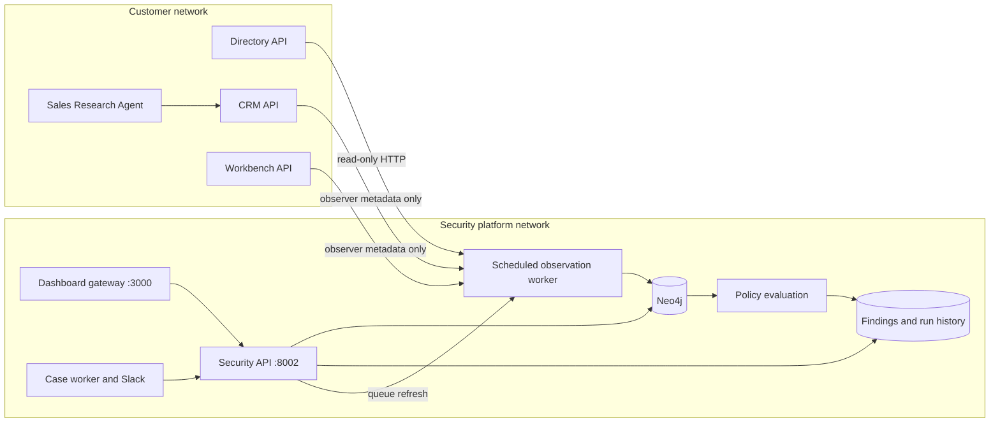

# Security observation API

The platform now has a running API and background observation worker. It collects
company metadata, maintains the graph, evaluates deterministic policies, and
persists findings. The separate `awasi-agent` service consumes those findings,
investigates with read-only model tools, coordinates Slack decisions, and runs
verified remediation. This guide describes the observation/API boundary; see
[architecture](architecture.md) and [model operations](model-operations.md) for
the complete workflow.



The observation worker and API share the `security-api` service. That service and
the separate case worker join the customer and platform networks. Customer
services do not join the Neo4j network. The platform mounts only its own `security-state` volume; it
has no customer SQLite mounts or CRM administrator, employee, or agent tokens.
All published ports bind to localhost. This is a local development boundary,
not a hardened production deployment.

## Start and use

Follow the [Docker startup guide](getting-started.md#3-run-the-full-docker-stack-optional)
first; it explains live-worker credentials and spending. Then use these commands:

```sh
make setup                 # Add missing API credentials; preserve existing secrets
make security-overview
make security-findings
make security-sync         # Returns a durable queued run, not the completed result
make security-runs         # Check its final state and per-source results
make security-connectors
make security-audit        # Operator actions and completed/interrupted syncs
```

API explorer: http://localhost:8002/docs. Use **Authorize** with either local
`SECURITY_VIEWER_TOKEN` (read access) or `SECURITY_OPERATOR_TOKEN` (read access,
manual refresh, and audit access) from `.env`. The Make commands supply these
without printing them. They use the viewer token for ordinary reads.

The directory and CRM keep their existing ports, data, and credentials. The API
starts independently of customer API health once Neo4j is ready. A customer
outage becomes connector failure evidence rather than a reason to erase history.

The worker requests an observation on startup. The v1 local configuration repeats
every **15 seconds**; the unset fallback remains 60 seconds.
`SECURITY_SYNC_INTERVAL` can be set locally to 5–3600 seconds, or `0` to disable
scheduled observations while retaining manually requested background runs.
Apply configuration changes by recreating the `security-api` service.

## API contract

All data routes require Bearer authentication. `/health`, `/docs`, and the OpenAPI
schema are public on the local service; health reveals no company data.

| Method | Route | Result / role |
| --- | --- | --- |
| GET | `/overview` | Entity counts, source freshness, finding counts, latest run |
| GET | `/entities` | Inventory page; optional `kind`, `present`, `limit`, `offset` |
| GET | `/entities/{id}` | One current or previously observed entity |
| GET | `/entities/{id}/relationships` | Current one-hop neighborhood, including incoming edges |
| GET | `/graph` | Bounded current graph; optional `kind`, `limit`, `edge_limit` |
| GET | `/policies` | Three detection rules, conditions and source coverage |
| GET | `/connectors` | Last success/attempt, safe error codes, freshness |
| GET | `/findings` | Persistent finding page; optional `status=open` or `resolved` |
| GET | `/findings/{id}` | Evidence, reason, suggested fix, latest 100 transition events and total event count |
| GET | `/cases` | Case page with current workflow status |
| GET | `/cases/{case_id}` | Case details, evidence, actions and timeline |
| POST | `/cases/{case_id}/decisions` | Operator: submit a decision for workflow validation |
| POST | `/sync-runs` | Operator: enqueue a refresh; optional empty JSON object only |
| GET | `/sync-runs` | Run history page |
| GET | `/sync-runs/{id}` | Queued/running/final state and source results |
| GET | `/audit` | Operator: platform action history page |
| GET | `/health` | SQLite, Neo4j connectivity and worker liveness; 503 if unavailable |

Both viewer and operator can access the read routes except `/audit`. Invalid or
missing tokens return 401; insufficient role returns 403. Missing or foreign
records return 404. Invalid filters and unknown POST fields return 422.
Dependency failures return a generic 503 without exception details or credentials.

List pages return `items`, `total`, `limit`, and `offset`. Limits are 1–200 and
offsets 0–100000. Graph edges are capped at 500; `truncated` indicates a partial
view. Every returned edge has both endpoints in the returned nodes. A filtered
graph shows edges within that selection; use the entity neighborhood route to
follow connections to other kinds.

Entity `id` is a stable URL-safe encoding of its company/type/source key. Use the
returned ID in URLs; `source_id` retains the original identifier such as
`emp-maya-chen`. This keeps directory identities distinct from application
accounts. The service derives company scope from its authenticated configuration,
never a request-supplied company ID or connector URL. The runtime currently
serves Helio only; the scoping tests do not imply production multi-tenant readiness.

`POST /sync-runs` returns **202** plus `Location: /sync-runs/{id}`. A request while
one is queued/running returns **409** and that run's ID. Poll its GET route for
`succeeded`, `partial`, `failed`, or `interrupted`. A successful HTTP enqueue is
not a successful observation. Run results identify individual source failures.

## Finding lifecycle and evidence

The existing graph posture policy detects an inactive employee whose agent retains an active
grant with customer read/write scope to a confidential resource. This policy
does not cover every company risk or establish a behavioral baseline.

Each finding has a stable UUID, rule, severity, affected entity identifiers,
first/last seen times, evidence timestamps, reason, suggested fix, and lifecycle
history. Current inventory is in Neo4j; findings, transition evidence snapshots,
sync jobs, and platform audit records are in the separate SQLite platform store.

- Repeated detection updates the same finding. Unchanged observations do not add
  duplicate transition events. There is no notification sender in this milestone.
- Fresh explicit evidence of revocation, an active owner, a non-confidential
  resource, or removal of relevant scopes resolves the finding.
- Failed/stale sources, skipped syncs, missing graph paths, and disappeared grants
  cannot resolve it. The previous state remains and `assessment` becomes `unknown`.
- Evidence older than 15 minutes is marked unverified even without another run.
  `status` records the last established open/resolved state; inspect
  `assessment`, `evidence_fresh`, `coverage_complete`, and the timestamps too.
- If the same risky relationship returns, the existing finding reopens with its
  original ID and a new transition event.
- A lifecycle event retains the evidence used at that transition. This supplements
  the graph's latest-state projection; it is not a complete activity-event archive.

A previously revoked Sales Research Agent grant can legitimately leave the finding
list empty. A fresh v1 reset seeds its active grant for the offboarding scenario. Integration tests use
isolated companies to exercise the full open → unverified → recovered → resolved
lifecycle without resetting your running simulator or fabricating findings.

## Reliability and boundaries

SQLite transactions and a unique active-run index prevent overlapping platform
jobs. A process lock permits only one API/worker process per platform database;
run Uvicorn with its default single worker. Queued runs survive restart. A running
job interrupted by a process crash is marked `interrupted` on restart, affected
assessments become unverified, and the next scheduled/manual observation retries.
Finding updates and run completion commit together. Older evaluations cannot
overwrite newer assessments.

Source observations are individually atomic, not one atomic snapshot of the whole
company. API views include freshness and provenance. Use `make security-sync` for
an extra observation and `make security-runs` to inspect the result.

The credentials represent local viewer/operator roles, not individual human
identities. Production SSO, per-user audit identity, tenant provisioning,
distributed workers, retention policies, and deployment hardening remain future
work. The [local dashboard](dashboard.md) and optional
[activity ingestion and recovery](activity-processing.md) are implemented, as are
model investigation, Slack approval, and verified remediation in the case worker.
The platform's CRM observer cannot execute remediation even if asked to do so.

## Verification

```sh
make test                 # Unit/API/SQLite checks; real Neo4j tests may skip
make test-integration     # Full suite with real Neo4j and isolated HTTP services
```

Tests cover authorization, company scoping, bounded queries, durable queuing,
concurrency, crash recovery, finding transitions, secret-safe failures, and the
full API → worker → directory/CRM → Neo4j → finding-history flow. Integration
tests delete only their own `test-*` graph namespaces.


## v1 observation scope

The registry exposes `inactive_owner_agent_access`, `public_app_confidential_data`,
and `agent_unapproved_destination`, together with the decision rules and playbooks.
`/policies` reports each rule's source coverage. `/overview` reports observation,
finding, activity, and case-worker/Slack status where configured.

The optional activity pipeline remains separate. A denied CRM request is evidence,
not automatically a new case under these snapshot-based rules. Existing activity
incidents remain readable; no migration silently declares them resolved. Current
limitations are tracked in [known limitations](known-limitations.md); historical
implementation decisions live in the [archived plan](archive/awasi-v1-plan.md).
