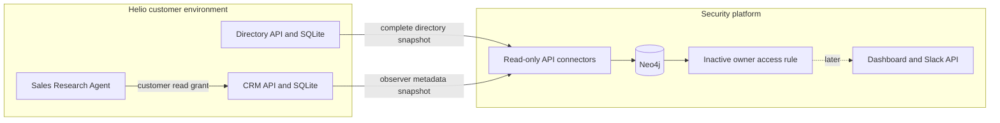

# Company security graph

Neo4j belongs to the security platform. The simulator represents the customer
environment. The security API and worker are now implemented; see the
[backend workflow](backend.md). The future dashboard and Slack interface will call
that backend; they will not connect directly to the graph database or carry CRM
administration credentials.



The services use separate customer and platform Compose networks and data volumes.
Only the API/worker and diagnostic connector container join both networks.
The `graph-sync` container has no customer database mounts
and receives only the observer token and graph credentials. It cannot edit
customers or revoke access through the CRM. Neo4j and both source APIs publish
only to localhost.

## Run and inspect

```sh
make setup              # Add missing credentials; preserve existing values
make up                 # Start directory, CRM, Neo4j and preserve data volumes
make graph-sync         # One complete observation per source
make graph-status       # Counts, last-success times, errors, freshness
make graph-risks        # Inactive owners whose agents retain sensitive access
```

Open http://localhost:7474/browser/, connect to `bolt://localhost:7687`, and use
username `neo4j` with `NEO4J_PASSWORD` from the local `.env` file. Do not share the
file or expanded Compose configuration. To see the current graph, run:

```cypher
MATCH p=(a:Entity {company_id:'helio', present:true})-[r]->(b:Entity)
WHERE r.present=true AND b.present=true
RETURN p LIMIT 200;
```

Focus on Maya and her agent, including the current grant even if revoked:

```cypher
MATCH p=(e:Employee {company_id:'helio', id:'emp-maya-chen'})
        -[:OWNS]->(:Agent)-[:HAS_GRANT]->(:AccessGrant)-[:ON]->(:DataResource)
RETURN p;
```

Click nodes and relationships to inspect status, scopes, source and timestamps.
Timestamps are UTC Unix seconds; Cypher can render one with
`datetime({epochMillis:toInteger(n.last_observed_at * 1000)})`.
Neo4j Browser is a development viewer; the product dashboard is not built yet.

## What is represented

| Node | Source | Meaning |
| --- | --- | --- |
| Employee / Team | Directory | Employment status and membership |
| App | CRM | Helio CRM and its declared owner |
| AppAccount | CRM | CRM employee identity linked to its directory employee |
| Agent | CRM | Sales Research Agent, owned by Maya |
| ServiceAccount | CRM | CRM administrator and security observer, owned by Casey |
| DataResource | CRM | Customer database (confidential) and access metadata (internal) |
| AccessGrant | CRM | Principal, scopes, target, active/revoked status and version |
| Source | Platform | Last attempt, last success and connector health |

Relationships: `MEMBER_OF`, `IDENTITY_OF`, `OWNS`, `USES`, `STORES`, `HAS_GRANT`,
and `ON`. An app's `STORES` edge describes its resource; customer rows are never
copied. The two resources are logical metadata records for the existing CRM,
not two new applications or a completed eight-app simulator.

With the current fixtures, there are **54 entity nodes, 2 source nodes and 75
relationships**: 20 employees, 5 teams, 1 app, 20 app accounts, 1 agent,
2 service accounts, 2 resources and 3 grants.

## Synchronization contract

- Directory `GET /snapshot` reads teams and employees in one SQLite transaction.
- CRM `GET /inventory` reads app/resources/accounts/grants in one transaction,
  authorized by an active observer metadata grant or an administrator.
- Both declare `schema_version: 1`, `company_id: helio`, and `complete: true`.
  Missing fields, unsupported versions, duplicate IDs, and invalid internal
  references reject the whole source observation.
- Connectors make bounded, read-only HTTP requests. They refuse redirects and
  discard fields outside the metadata schema. Neither tokens, credential hashes,
  audit payloads nor customer rows are sent to Neo4j.
- The directory sync runs first. CRM ownership links require existing directory
  employees; unresolved endpoints roll back the entire CRM import.
- Stable keys and uniqueness constraints prevent duplicate entities. Each source
  import uses one Neo4j transaction. Each relationship retains `source`,
  `first_seen`, `last_observed_at`, and `present`.
- A successful complete snapshot marks previously observed missing entities and
  relationships `present: false`. Absence is not interpreted as revocation.
  A revoked grant remains visible with its explicit status and version.
- Connector or validation failure retains the last known graph, records a safe
  error code, and marks coverage incomplete. Observations older than 15 minutes
  are stale even if the last attempt succeeded. Newer observations cannot be
  overwritten by older requests finishing late.

The security API worker automatically synchronizes every 60 seconds by default.
Use `make security-sync` to queue a refresh and update persistent findings.
`make graph-sync` remains a graph-only diagnostic. Reads are atomic within each
source, not across both sources. Each source's observation time stays visible.

## Demonstrated security value

The first rule follows:

`Inactive employee → owns agent → active grant → confidential data resource`

For a fresh simulator, `make offboard` followed by `make graph-sync` and
`make graph-risks` reveals the Sales Research Agent's remaining access.
`make revoke-agent` changes the grant in the CRM; the next graph sync observes
the revocation and clears that finding. Graph edits do not enforce CRM access.

If the existing CRM grant is already revoked, that finding correctly stays
absent. Do not reset the environment merely to force a risk to appear. Isolated
integration tests exercise the entire lifecycle without changing Helio's data.
An empty findings list evaluates this one rule only. It does not establish that
the company is secure, particularly when `coverage_complete` is false.

## Tests and current limits

```sh
make test               # Unit/API/SQLite tests; Neo4j tests skip without config
make test-integration   # Entire suite with real Neo4j, reading local .env privately
```

Integration tests create unique `test-*` namespaces and delete only their own
nodes afterward. They cover real API-to-graph sync, observer denial, idempotency,
concurrent imports, stale observations, rollback, missing grants, and offboarding
followed by revocation. They never reset the running company's directory or CRM.

This is a single-company development backend. Company-key scoping is tested,
but production tenant authorization, identity federation, dedicated service
credentials for Neo4j, TLS, secret rotation and deployment isolation are future
work. The local directory API is intentionally unauthenticated. There is no LLM,
activity-stream ingestion, automatic remediation, dashboard or Slack workflow yet.
Scheduled metadata observation is implemented. The graph retains latest known
state and first/last observation times; the platform additionally stores finding
transition evidence. Neither is a complete activity history, and neither can
recover changes that happened before observation.

The deployment and transaction model follow the official
[Neo4j Docker guide](https://neo4j.com/docs/operations-manual/current/docker/introduction/)
and [Python transaction documentation](https://neo4j.com/docs/python-manual/current/transactions/).
