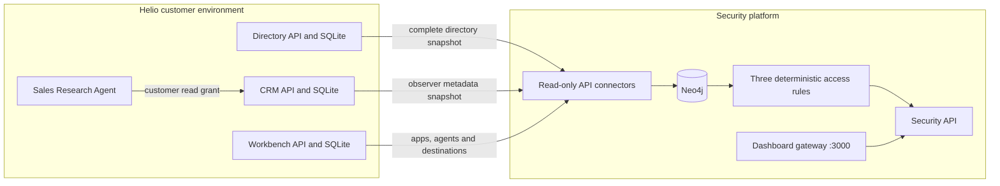

# Company security graph

Neo4j belongs to the security platform. The simulator represents the customer
environment. The security API and worker are now implemented; see the
[backend workflow](backend.md). The [dashboard](dashboard.md) calls that backend
through a server-side gateway. It does not connect directly to the graph database
or carry CRM administration credentials. Slack decisions and remediation run in the separate case worker; see
[architecture](architecture.md).



The services use separate customer and platform Compose networks and data volumes.
The security API/observation worker and the separate case worker join both networks.
Neither mounts customer databases. Observation uses read credentials; the case
worker has separate scoped action credentials for approved workflows. Neo4j and
source API ports bind to localhost.

## Run and inspect

Start the services using the [Docker guide](getting-started.md#3-run-the-full-docker-stack-optional),
which explains when live workers and credentials are required. Then inspect them:

```sh
make setup              # Add missing credentials; preserve existing values
make security-sync      # Queue an observation; inspect completion with security-runs
make security-overview  # Counts, source freshness and current findings
make security-findings  # Current findings across configured rules
```

Open http://localhost:7474/browser/, connect to `bolt://localhost:7687`, and use
username `neo4j` with `NEO4J_PASSWORD` from the local `.env` file. Do not share the
file or expanded Compose configuration. To see the current graph, run:

```cypher
MATCH p=(a:Entity {company_id:'helio', present:true})-[r]->(b:Entity)
WHERE r.present=true AND b.present=true
RETURN p LIMIT 200;
```

Focus on Maya and her agent, including the current grant even if revoked:

```cypher
MATCH p=(e:Employee {company_id:'helio', id:'emp-maya-chen'})
        -[:OWNS]->(:Agent)-[:HAS_GRANT]->(:AccessGrant)-[:ON]->(:DataResource)
RETURN p;
```

Click nodes and relationships to inspect status, scopes, source and timestamps.
Timestamps are UTC Unix seconds; Cypher can render one with
`datetime({epochMillis:toInteger(n.last_observed_at * 1000)})`.
Neo4j Browser is a development viewer. The product graph view is available in
the [dashboard](http://localhost:3000/#graph), with entity inspection and filtering.

## What is represented

| Node | Source | Meaning |
| --- | --- | --- |
| Employee / Team | Directory | Employment status and membership |
| App | CRM / Workbench | CRM and internal apps, ownership and visibility |
| AppAccount | CRM | CRM identity linked to its directory employee |
| Agent | CRM / Workbench | Automated principals and their ownership |
| ServiceAccount | CRM | Administration, observation and other service identities |
| DataResource | CRM | Logical data resources and their classification |
| AccessGrant | CRM | Principal, scopes, target, active/revoked status and version |
| Connection / Destination | Workbench | Agent connections and destination approval metadata |
| Audience | Workbench | Public exposure of an internal app |
| Source | Platform | Last attempt, last success and connector health |

Relationships include `MEMBER_OF`, `IDENTITY_OF`, `OWNS`, `USES`, `STORES`,
`HAS_GRANT`, `ON`, `ACTS_AS`, `EXPOSED_TO`, `HAS_CONNECTION`, and `TO`.
An app's `STORES` edge describes its logical resource; customer rows are never
copied. Workbench relationships connect internal apps and agents to CRM principals,
public audiences, and external destinations.

Inventory counts depend on the configured sources and current demo state. Use
`make security-overview` for observed counts rather than assuming a fixed fixture
size. The dashboard groups CRM accounts under their people while retaining the
underlying identity relationships.

## Synchronization contract

- Directory `GET /snapshot` reads teams and employees in one SQLite transaction.
- CRM `GET /inventory` reads app/resources/accounts/grants in one transaction,
  authorized by an active observer metadata grant or an administrator.
- Workbench `GET /inventory` supplies apps, agents, connections and destinations
  using its observer credential.
- Sources declare `schema_version: 1`, `company_id: helio`, and `complete: true`.
  Missing fields, unsupported versions, duplicate IDs, and invalid internal
  references reject the whole source observation.
- Connectors make bounded, read-only HTTP requests. They refuse redirects and
  discard fields outside the metadata schema. Neither tokens, credential hashes,
  audit payloads nor customer rows are sent to Neo4j.
- The directory sync runs first. CRM ownership links require existing directory
  employees; unresolved endpoints roll back the entire CRM import.
- Stable keys and uniqueness constraints prevent duplicate entities. Each source
  import uses one Neo4j transaction. Each relationship retains `source`,
  `first_seen`, `last_observed_at`, and `present`.
- A successful complete snapshot marks previously observed missing entities and
  relationships `present: false`. Absence is not interpreted as revocation.
  A revoked grant remains visible with its explicit status and version.
- Connector or validation failure retains the last known graph, records a safe
  error code, and marks coverage incomplete. Observations older than 15 minutes
  are stale even if the last attempt succeeded. Newer observations cannot be
  overwritten by older requests finishing late.

The v1 local configuration synchronizes every 15 seconds (60-second fallback).
Use `make security-sync` to queue a refresh and update persistent findings.
Reads are atomic within each
source, not across all sources. Each source's observation time stays visible.

## Demonstrated security value

The first rule follows:

`Inactive employee → owns agent → active grant → confidential data resource`

For a fresh simulator, `make offboard` followed by the next scheduled observation
and `make security-findings` reveals the Sales Research Agent's remaining access.
`make revoke-agent` changes the grant in the CRM; the next graph sync observes
the revocation and clears that finding. Graph edits do not enforce CRM access.

If the existing CRM grant is already revoked, that finding correctly stays
absent. Do not reset the environment merely to force a risk to appear. Isolated
integration tests exercise the entire lifecycle without changing Helio's data.
An empty findings list describes the configured rules only. It does not establish that
the company is secure, particularly when `coverage_complete` is false.

## Tests and current limits

```sh
make test               # Unit/API/SQLite tests; Neo4j tests skip without config
make test-integration   # Entire suite with real Neo4j, reading local .env privately
```

Integration tests create unique `test-*` namespaces and delete only their own
nodes afterward. They cover real API-to-graph sync, observer denial, idempotency,
concurrent imports, stale observations, rollback, missing grants, and offboarding
followed by revocation. They never reset the running company's directory or CRM.

This is a single-company development backend. Company-key scoping is tested,
but production tenant authorization, identity federation, dedicated service
credentials for Neo4j, TLS, secret rotation and deployment isolation are future
work. The local directory API is intentionally unauthenticated. There is no LLM,
automatic remediation, or Slack workflow yet. Activity capture and ingestion remain
available separately as evidence; they do not produce new policy incidents.
The local dashboard visualizes the observed graph and persisted findings.
Scheduled metadata observation is implemented. The graph retains latest known
state and first/last observation times; the platform additionally stores finding
transition evidence. Neither is a complete activity history, and neither can
recover changes that happened before observation.

The deployment and transaction model follow the official
[Neo4j Docker guide](https://neo4j.com/docs/operations-manual/current/docker/introduction/)
and [Python transaction documentation](https://neo4j.com/docs/python-manual/current/transactions/).
